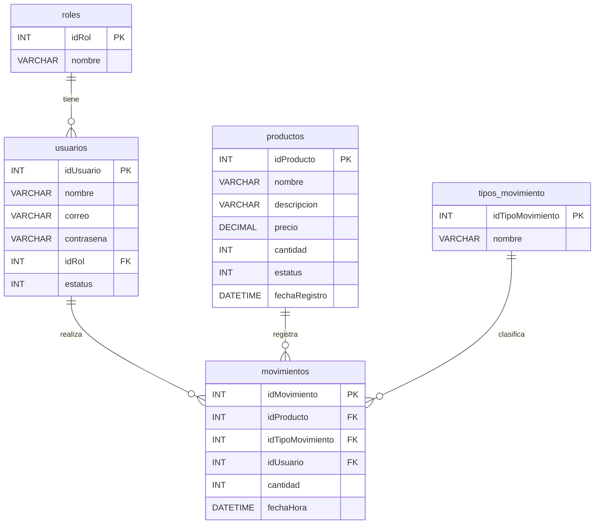

# Sistema de Inventario de Almacén

Aplicación web para administrar el inventario de un almacén, desarrollada como parte de la Evaluación Técnica de Programación de Grupo Castores.

**Autor:** Alejandro Mejía Herrera

## Datos del desarrollo

| Concepto | Detalle |
|---|---|
| IDE utilizado | IntelliJ IDEA 2026.3 |
| Lenguaje | Java 17 (JDK Eclipse Temurin 17.0.20.1) |
| Framework | Spring Boot 4.0.9 (Spring MVC, Spring Security, Spring Data JPA, Thymeleaf) |
| Gestor de dependencias | Maven (incluye Maven Wrapper) |
| DBMS | MySQL Community Server 8.4.13 |
| Patrón de diseño | MVC (Modelo - Vista - Controlador) con capa de servicio |

## Funcionalidades

- **Inicio de sesión** con correo y contraseña. Las contraseñas se guardan cifradas con BCrypt.
- **Módulo de inventario**
  - Lista de productos con filtro: todos, activos e inactivos.
  - Agregar productos nuevos (siempre inician con existencia 0).
  - Entrada de productos: aumenta la existencia. Si se intenta disminuir (cantidad 0 o negativa) se muestra un mensaje de error.
  - Dar de baja y reactivar productos (baja lógica: solo cambia el estatus, el registro no se borra).
- **Módulo de salida de productos**: solo muestra productos activos y no permite sacar más de lo que hay en existencia (muestra un mensaje de error).
- **Módulo de histórico**: todos los movimientos de entrada y salida con fecha, hora y usuario que los realizó, con filtro por tipo de movimiento.

### Permisos por rol

| Permiso | Administrador | Almacenista |
|---|:---:|:---:|
| Ver módulo inventario | ✓ | ✓ |
| Agregar nuevos productos | ✓ | ✕ |
| Aumentar inventario | ✓ | ✕ |
| Dar de baja / reactivar un producto | ✓ | ✕ |
| Ver módulo para salida de productos | ✕ | ✓ |
| Sacar inventario del almacén | ✕ | ✓ |
| Ver módulo del histórico | ✓ | ✕ |

Los permisos se validan en el servidor con Spring Security, no solo ocultando botones. Si un usuario escribe a mano la URL de un módulo que no le corresponde, ve la página de **Acceso denegado**.

### Detalles técnicos relevantes

- **Transacciones:** cada entrada y salida actualiza la existencia y registra el movimiento dentro de una misma transacción. Si algo falla, no se guarda ninguno de los dos cambios.
- **Concurrencia:** al registrar una entrada o salida, el producto se bloquea (`SELECT ... FOR UPDATE`) para que dos movimientos simultáneos no dejen la existencia en un valor incorrecto.
- **Integridad en la base de datos:** además de las validaciones de la aplicación, la tabla `productos` tiene un `CHECK (cantidad >= 0)`.
- **Credenciales:** la contraseña de MySQL no está en el código; se lee de la variable de entorno `DB_PASSWORD`.

## Diagrama relacional



> La columna `usuarios.contrasena` se amplió de `VARCHAR(25)` a `VARCHAR(100)` porque el hash de BCrypt mide 60 caracteres.

## Estructura del proyecto

```
inventario/
├── SCRIPTS/
│   ├── 01_crear_base_datos.sql     # Creación de la base de datos y sus tablas
│   └── 02_datos_iniciales.sql      # Roles, tipos de movimiento, usuarios y productos de prueba
├── src/main/java/com/castores/inventario/
│   ├── model/        # Entidades JPA (Modelo)
│   ├── repository/   # Acceso a datos
│   ├── service/      # Reglas de negocio y búsqueda de usuarios para el login
│   ├── controller/   # Controladores (Controlador)
│   ├── config/       # Configuración de seguridad y cifrado inicial de contraseñas
│   └── exception/    # Excepción para reglas de negocio
├── src/main/resources/
│   ├── templates/    # Vistas Thymeleaf (Vista)
│   ├── static/css/   # Hoja de estilos
│   └── application.properties
└── pom.xml
```

## Pasos para correr la aplicación

### Requisitos previos

- JDK 17 o superior
- MySQL 8.4
- No es necesario instalar Maven: el proyecto incluye Maven Wrapper (`mvnw` / `mvnw.cmd`).

### 1. Clonar el repositorio

```bash
git clone <URL-del-repositorio>
cd inventario
```

### 2. Crear la base de datos

Ejecuta los scripts de la carpeta `SCRIPTS` en este orden, desde MySQL Workbench o desde la terminal:

```bash
mysql -u root -p < SCRIPTS/01_crear_base_datos.sql
mysql -u root -p < SCRIPTS/02_datos_iniciales.sql
```

### 3. Configurar la conexión

La conexión está en `src/main/resources/application.properties`. Usa la base `inventario` en `localhost:3306` con el usuario `root`. La contraseña de MySQL se lee de la variable de entorno `DB_PASSWORD`.

- **Desde IntelliJ IDEA:** en la configuración de ejecución de `InventarioApplication` (*Edit Configurations → Environment variables*), agrega `DB_PASSWORD=tu_contraseña`.
- **Desde la terminal (Windows):**
  ```bash
  set DB_PASSWORD=tu_contraseña
  ```

Si tu usuario de MySQL no es `root`, cambia `spring.datasource.username` en el mismo archivo.

### 4. Ejecutar

Desde IntelliJ IDEA, abre el proyecto y ejecuta la clase `InventarioApplication`.

O desde la terminal, en la carpeta del proyecto:

```bash
mvnw.cmd spring-boot:run
```

(En Linux o Mac: `./mvnw spring-boot:run`)

### 5. Entrar a la aplicación

Abre http://localhost:8080 e inicia sesión con alguno de estos usuarios de prueba:

| Rol | Correo | Contraseña |
|---|---|---|
| Administrador | juan.perez@gmail.com | admin123 |
| Almacenista | pedro.martinez@gmail.com | almacen123 |

> El script 02 inserta las contraseñas en texto plano para facilitar la instalación. Al arrancar, la aplicación las detecta y las reemplaza por su hash BCrypt (clase `DatosIniciales`).

## Mensajes de error contemplados

| Situación | Mensaje |
|---|---|
| Credenciales incorrectas | Correo o contraseña incorrectos. |
| Producto sin nombre | El nombre del producto es obligatorio. |
| Producto con nombre repetido | Ya existe un producto con el nombre X. |
| Precio negativo | El precio debe ser mayor o igual a 0. |
| Entrada con cantidad 0 o negativa | No se puede disminuir el inventario desde la entrada de productos. La cantidad debe ser mayor a 0. |
| Entrada a un producto dado de baja | No se puede agregar inventario a un producto dado de baja. |
| Salida sin seleccionar producto | Selecciona un producto. |
| Salida con cantidad 0 o negativa | La cantidad a sacar debe ser mayor a 0. |
| Salida mayor a la existencia | No hay suficiente inventario de X. Intentaste sacar N y solo hay M en existencia. |
| Acceso a un módulo sin permiso | Página de Acceso denegado. |
